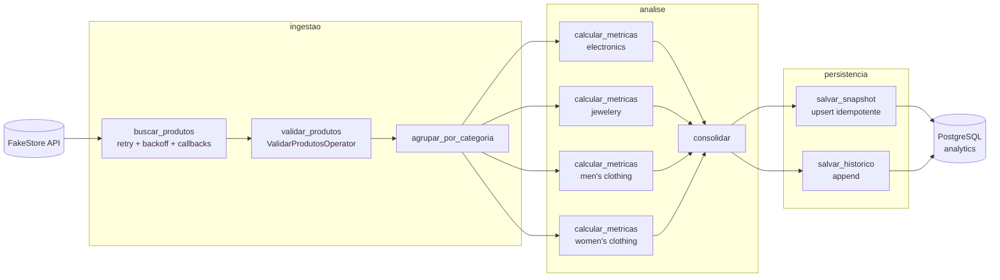

# ShopBrasil: métricas de preço por categoria com Apache Airflow

Atividade 01 da disciplina **Orquestração de Workflows** (pós-graduação em Engenharia de IA e MLOps, PUC Minas).

## O problema

Todas as manhãs, o time de pricing e os gerentes de categoria da ShopBrasil abrem um painel com preço médio, mínimo, máximo e quantidade de produtos por categoria para decidir as promoções do dia. Esse painel era alimentado por um script Python no cron, que tinha quatro problemas:

| Problema do script no cron | Como o pipeline resolve |
|---|---|
| A API oscila de madrugada e o script falha em silêncio | Retry com exponential backoff e alerta quando as tentativas acabam |
| Rodar de novo "na mão" duplica os números no banco | Gravação idempotente (upsert por dia e categoria) |
| Cada categoria nova exige editar o código | Dynamic Task Mapping: uma task por categoria, criada em tempo de execução |
| Ninguém sabe o que rodou nem quando | UI do Airflow com o histórico de cada execução, tentativa e log |

## Arquitetura



As três topologias pedidas aparecem assim na DAG:

- **Linear:** `buscar_produtos → validar_produtos → agrupar_por_categoria`.
- **Fan-out:** `calcular_metricas.expand(...)` cria uma instância por categoria. Hoje a API tem 4 categorias, mas se aparecer uma quinta, ela ganha uma task sozinha.
- **Fan-in:** `consolidar` recebe a lista com o resultado de todas as instâncias.

### Containers

| Serviço | Papel |
|---|---|
| `postgres-meta` | Banco interno do Airflow (runs, estados, XComs, connections, pools) |
| `postgres-analytics` | Base analítica da ShopBrasil, onde o pipeline grava |
| `airflow-init` | Roda uma vez: migra o banco, cria o usuário, a connection `postgres_shopbrasil` e o pool `ecommerce_pool` |
| `airflow-scheduler` | Agenda e executa as tasks (LocalExecutor) |
| `airflow-webserver` | Interface em http://localhost:8080 |

### Tabelas

| Tabela | Modo | Chave |
|---|---|---|
| `metricas_categoria` | Snapshot idempotente: uma linha por categoria por dia | `PRIMARY KEY (data_referencia, categoria)` |
| `historico_metricas_categoria` | Append: uma linha por categoria a cada coleta | `id` sequencial |

## Como executar

Pré-requisito: Docker Desktop (ou Docker Engine com Compose v2), com uns 4 GB de RAM livres.

```bash
git clone https://github.com/gabrielf54/shopbrasil-airflow.git
cd shopbrasil-airflow
docker compose up -d
```

No Linux/macOS, antes do `up`: `mkdir -p logs && chmod -R 777 logs`.

Na primeira vez, o Docker baixa as imagens (2 a 3 minutos). Depois:

1. Abra http://localhost:8080 e entre com `admin` / `admin`.
2. A DAG `shopbrasil_metricas_precos` já nasce ligada. Como o último horário das 06:00 já passou, o scheduler dispara a execução daquele dia logo em seguida.
3. Acompanhe pelo **Grid** e pelo **Graph**. As instâncias mapeadas aparecem com o nome da categoria.

Para consultar o resultado:

```bash
docker compose exec postgres-analytics psql -U shopbrasil -d analytics \
  -c "SELECT * FROM metricas_categoria ORDER BY data_referencia DESC, categoria;"
```

Ou conecte um cliente SQL em `localhost:5434` (usuário `shopbrasil`, senha `shopbrasil123`, banco `analytics`).

Para derrubar: `docker compose down` mantém os dados, e `docker compose down -v` apaga os bancos.

## Como testar os requisitos

**Idempotência.** Rode a mesma execução de novo (no Grid: selecione a run → *Clear*) ou dispare uma execução manual (*Trigger DAG*). A contagem de `metricas_categoria` continua igual, e só `dag_run_id` e `atualizado_em` mudam:

```sql
SELECT data_referencia, count(*) FROM metricas_categoria GROUP BY 1;
```

**Retry, backoff e alerta.** Em *Admin → Variables*, crie `fakestore_api_url` com um endereço inválido, por exemplo `https://fakestoreapi.com/fora-do-ar`, e dispare a DAG. A task `buscar_produtos` falha, avisa no log (`🔁 ... falhou na tentativa 1`) e tenta de novo com espera crescente. Para ver a recuperação, apague a Variable antes da última tentativa. Para ver o alerta, deixe as 5 tentativas falharem: o log da última mostra `ALERTA ENVIADO (simulado)` com a mensagem que iria para o canal do time.

**Pool.** No Gantt de uma execução, as 4 instâncias de `calcular_metricas` rodam no máximo 2 ao mesmo tempo. O pool aparece em *Admin → Pools*.

## Onde está cada requisito

| Requisito | Onde |
|---|---|
| TaskFlow API (`@dag`/`@task`), dependências pela chamada das funções | `dags/shopbrasil_metricas_precos.py`, última linha da DAG: `persistencia(analise(ingestao()))` |
| XComs automáticos via `return`, só com dados pequenos | `buscar_produtos` devolve só `id`, `title`, `category` e `price` |
| Linear, fan-out e fan-in | Grupos `ingestao` e `analise` |
| 06:00 em `America/Sao_Paulo`, pendulum, `start_date`, `catchup=False` | Decorador `@dag` |
| Retry com exponential backoff | `@task` de `buscar_produtos` |
| `try/except` + `raise` | Corpo de `buscar_produtos` |
| Callbacks de sucesso, retry e falha | `plugins/shopbrasil/callbacks.py`, ligados em `buscar_produtos` |
| Dynamic Task Mapping | `calcular_metricas.expand(lote=lotes)` |
| Pool `ecommerce_pool` com 2 slots | Criado no `airflow-init` (`docker-compose.yml`) e usado em `@task(pool=...)` |
| 2 ou mais TaskGroups | `ingestao`, `analise` e `persistencia` |
| PostgresHook + Connection, gravação idempotente | `salvar_snapshot`, com a connection `postgres_shopbrasil` |
| *Opcional:* operador customizado | `plugins/shopbrasil/operators.py` (`ValidarProdutosOperator`) |
| *Opcional:* tabela de histórico | `salvar_historico` → `historico_metricas_categoria` |
| *Opcional:* alerta | `alertar_falha`, `on_failure_callback` de todas as tasks |

## Decisões técnicas

**Upsert com chave natural para a idempotência.** O snapshot tem chave primária `(data_referencia, categoria)`, e a gravação usa `INSERT ... ON CONFLICT DO UPDATE`. Rodar de novo atualiza as linhas do dia em vez de criar outras. Na mesma transação, a task apaga do dia as categorias que sumiram do catálogo, para o snapshot refletir exatamente a última coleta. Se algo falhar no meio, o rollback deixa o dia como estava.

**`data_referencia` vem do intervalo da run, não do relógio.** A data é a do fim do intervalo, no fuso de Brasília: a run agendada de hoje às 06:00 cobre `[ontem 06:00, hoje 06:00]` e grava como hoje. Uma execução manual no mesmo dia cai no mesmo intervalo e, portanto, na mesma data, por isso substitui o snapshot em vez de duplicar. Usar `NOW()` faria um reprocessamento de ontem gravar como hoje.

**O histórico é append de propósito.** A tabela de histórico registra cada coleta como uma observação, com `coletado_em` e `dag_run_id`. Repetir uma execução acrescenta linhas, e isso é desejado: o objetivo é acompanhar a evolução dos preços. A deduplicação, quando precisar, é feita na consulta.

**Fuso ancorado no `start_date`.** O cron `0 6 * * *` é interpretado no fuso do `start_date` (`pendulum.datetime(..., tz="America/Sao_Paulo")`). Sem isso, o Airflow usaria UTC e a DAG rodaria às 03:00 de Brasília. Como o Brasil não tem horário de verão desde 2019, 06:00 de Brasília é sempre 09:00 UTC.

**Backoff calmo, com teto.** São 4 retries (5 tentativas no total), começando em 30s e dobrando a cada falha, até no máximo 10 minutos. No pior caso, o pipeline desiste uns 8 minutos depois da primeira falha e avisa, bem antes de o time chegar. O `execution_timeout` de 2 minutos impede que uma conexão pendurada segure a task para sempre.

**Validação que descarta, mas não esconde.** O `ValidarProdutosOperator` descarta produtos com schema inválido (registrando cada um no log) em vez de derrubar a execução por um item quebrado. Se não sobrar nenhum produto válido, ele falha, porque aí o problema é a API e não um produto.

**Callbacks e operador em `plugins/`.** A pasta `plugins/` entra no `sys.path` do Airflow. Deixar ali o código reutilizável mantém em `dags/` só a definição do fluxo.

**Sem imagem customizada.** A imagem oficial `apache/airflow:2.9.3-python3.11` já traz o provider do Postgres, `requests` e `pendulum`. As métricas são calculadas em Python puro, então o projeto não precisa de pandas nem de um `Dockerfile` próprio, e sobe mais rápido.

**`max_active_runs=1`.** Duas execuções simultâneas disputariam as mesmas linhas do snapshot, por isso só uma roda por vez.

## Estrutura

```
shopbrasil-airflow/
├── docker-compose.yml               ambiente completo (Airflow + 2 Postgres)
├── dags/
│   └── shopbrasil_metricas_precos.py
├── plugins/shopbrasil/
│   ├── callbacks.py                 sucesso, retry e alerta de falha
│   └── operators.py                 ValidarProdutosOperator
└── sql/
    └── init.sql                     tabelas da base analítica
```
