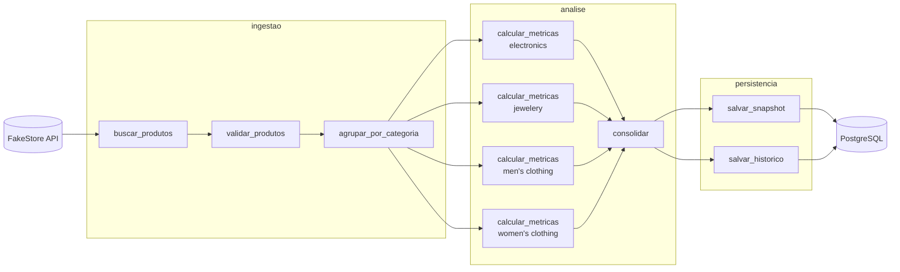

# ShopBrasil - métricas de preço por categoria com Airflow

Atividade 01 de Orquestração de Workflows (pós em Engenharia de IA e MLOps, PUC Minas).

## Contexto

O time de pricing da ShopBrasil abre todo dia de manhã um painel com preço médio, mínimo, máximo e quantidade de produtos por categoria. Esse painel era alimentado por um script Python no cron, que falhava em silêncio quando a API caía, duplicava os dados quando alguém rodava de novo na mão e precisava ser editado a cada categoria nova.

Este projeto troca o script por uma DAG no Airflow que roda às 06:00 (horário de Brasília), tenta de novo quando a API falha, cria uma task por categoria automaticamente e grava no Postgres sem duplicar.

## Arquitetura



- **Linear:** buscar_produtos -> validar_produtos -> agrupar_por_categoria
- **Fan-out:** `calcular_metricas.expand(...)` cria uma task por categoria (hoje são 4)
- **Fan-in:** `consolidar` junta o resultado de todas

O `docker-compose.yml` sobe dois Postgres: um é o banco interno do Airflow e o outro (`postgres-analytics`) é a base onde o pipeline grava. O `airflow-init` roda uma vez para criar o usuário, a connection `postgres_shopbrasil` e o pool `ecommerce_pool`. Depois ficam rodando o scheduler e o webserver.

A base tem duas tabelas: `metricas_categoria` (uma linha por categoria por dia) e `historico_metricas_categoria` (acrescenta linhas a cada execução).

## Como rodar

Precisa de Docker com Compose v2.

```bash
git clone https://github.com/gabrielf54/shopbrasil-airflow.git
cd shopbrasil-airflow
docker compose up -d
```

No Linux/macOS, antes do `up`: `mkdir -p logs && chmod -R 777 logs`.

Na primeira vez demora uns minutos para baixar as imagens. Depois é só abrir http://localhost:8080 (`admin` / `admin`). A DAG `shopbrasil_metricas_precos` já sobe ligada e roda a execução do dia logo em seguida.

Para ver o resultado no banco:

```bash
docker compose exec postgres-analytics psql -U shopbrasil -d analytics \
  -c "SELECT * FROM metricas_categoria ORDER BY data_referencia DESC, categoria;"
```

O banco também fica exposto em `localhost:5434` (`shopbrasil` / `shopbrasil123`, banco `analytics`).

`docker compose down` para tudo e mantém os dados; `docker compose down -v` apaga os bancos.

## Como testar

**Idempotência:** rode a mesma execução de novo (Clear no Grid) ou dispare manualmente. O número de linhas em `metricas_categoria` não muda, só o `dag_run_id` e o `atualizado_em`.

```sql
SELECT data_referencia, count(*) FROM metricas_categoria GROUP BY 1;
```

**Retry e alerta:** em Admin > Variables, crie `fakestore_api_url` com um endereço inválido (ex.: `https://fakestoreapi.com/fora-do-ar`) e dispare a DAG. O log de `buscar_produtos` mostra `[RETRY]` a cada tentativa. Se apagar a Variable antes da última tentativa, a task se recupera. Se deixar as 5 tentativas falharem, a última mostra o `[ALERTA]`.

**Pool:** no Gantt de uma execução dá para ver que só 2 `calcular_metricas` rodam ao mesmo tempo.

## Onde está cada requisito

| Requisito | Onde |
|---|---|
| TaskFlow (`@dag`/`@task`) e dependências pela chamada das funções | `dags/shopbrasil_metricas_precos.py`, linha `persistencia(analise(ingestao()))` |
| XCom via `return`, só dados pequenos | `buscar_produtos` devolve só `id`, `title`, `category` e `price` |
| Linear, fan-out e fan-in | grupos `ingestao` e `analise` |
| 06:00 em `America/Sao_Paulo` com pendulum, `catchup=False` | decorador `@dag` |
| Retry com exponential backoff, `try/except` + `raise` | `buscar_produtos` |
| Callbacks de sucesso, retry e falha | `plugins/shopbrasil/callbacks.py` |
| Dynamic Task Mapping | `calcular_metricas.expand(lote=lotes)` |
| Pool `ecommerce_pool` (2 slots) | criado no `airflow-init`, usado em `calcular_metricas` |
| TaskGroups | `ingestao`, `analise` e `persistencia` |
| PostgresHook + Connection, gravação idempotente | `salvar_snapshot` |
| Opcional: operador customizado | `plugins/shopbrasil/operators.py` |
| Opcional: tabela de histórico | `salvar_historico` |
| Opcional: alerta | `alertar_falha` (`on_failure_callback`) |

## Decisões

A idempotência vem da chave primária `(data_referencia, categoria)` com `INSERT ... ON CONFLICT DO UPDATE`. Se rodar de novo, atualiza as linhas do dia em vez de criar outras. A `data_referencia` sai do `data_interval_end` da run e não do `NOW()`, assim reprocessar um dia antigo grava naquele dia e não no dia de hoje.

O fuso fica no `start_date` com pendulum porque o Airflow interpreta o cron no fuso do `start_date`. Sem isso a DAG rodaria às 06:00 UTC, que são 03:00 em Brasília.

No retry usei 4 retries com backoff começando em 30s e teto de 10 minutos. Num teste com a API fora do ar as esperas foram 35s, 1min56, 2min33 e 7min54, e o alerta saiu uns 13 minutos depois da primeira falha.

O histórico é append de propósito, porque a ideia é ver como os preços mudam ao longo do tempo. Ali repetir uma execução gera linhas novas.

Não fiz imagem customizada: a imagem oficial do Airflow 2.9.3 já tem o provider do Postgres e o `requests`, e as métricas são só média, mínimo e máximo, então não precisei de pandas.

## Limitações

- O alerta é simulado: só escreve a mensagem no log. O próximo passo seria mandar para um webhook do Slack.
- As senhas estão fixas no `docker-compose.yml` para o projeto subir com um comando só. O certo seria usar um `.env`.
- Se a API ficar fora do ar o dia todo, não existe cache: o snapshot do dia não é gravado e o painel fica com os dados do dia anterior.
